# Claude 安全助手小工具 Mac 安装与使用指南

这款一键搭建 Claude 安全环境的小工具，经过了两个群里 300 多位群友的测试。感谢大家把安装、配置和使用中遇到的问题反馈给我们，我们根据这些反馈做了一次全面优化和升级。

之前每出一个新版本，群友都得重新下载，再走一遍安装流程。对不太懂技术的朋友来说，每更新一次就要再折腾一遍。这次我们把更新直接做进了小工具里。

之前装过小工具的朋友，可以先退出并删除旧版，再按下面的步骤安装新版「Claude 安全助手」。以后有新版本，在助手里点击「检查更新」，按提示完成更新即可。手动下载、部署和安装，这次走一遍就够了。

## 1. 下载小工具，安装 Docker

先下载 Claude 安全助手的 Mac 安装包。Apple 芯片和 Intel 芯片的 Mac 都可以用这个通用版。[下载 Mac 版安装包](https://github.com/markjizhi/claude-safe-client/releases/download/v0.5.1/ClaudeSafeClient-0.5.1-universal.dmg)

接着安装并打开 Docker Desktop。下载时选与你的 Mac 芯片对应的版本。如果已经装好了 Docker Desktop，直接打开，等它启动完成即可。[Docker Desktop 安装说明](https://docs.docker.com/desktop/setup/install/mac-install/)

## 2. 安装并打开 Claude 安全助手

双击下载的 `.dmg` 文件，把左边的「Claude 安全助手」图标拖到右边的「Applications」文件夹。

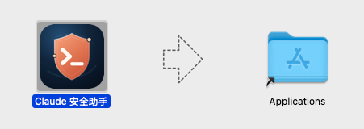

打开访达，在「应用程序」里找到并打开「Claude 安全助手」。

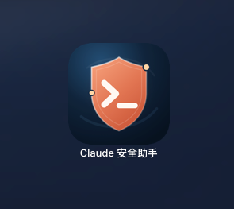

### 首次打开时，macOS 提示「未打开」

如果你已经看到「授权访问」页面，可以直接看第 3 步。遇到下图的「Apple 无法验证」提示时，先确认安装包来自本项目的 GitHub 发布页，并确认来源可信、文件完整，再继续操作。[GitHub 发布页](https://github.com/markjizhi/claude-safe-client/releases)

**1. 点「完成」关闭提示。**

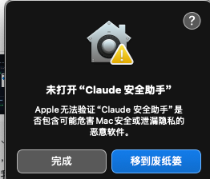

**2. 打开「系统设置 → 隐私与安全性」。** 向下滚动到「安全性」，找到「已阻止『Claude 安全助手』以保护 Mac」的提示，点右侧的「仍要打开」。

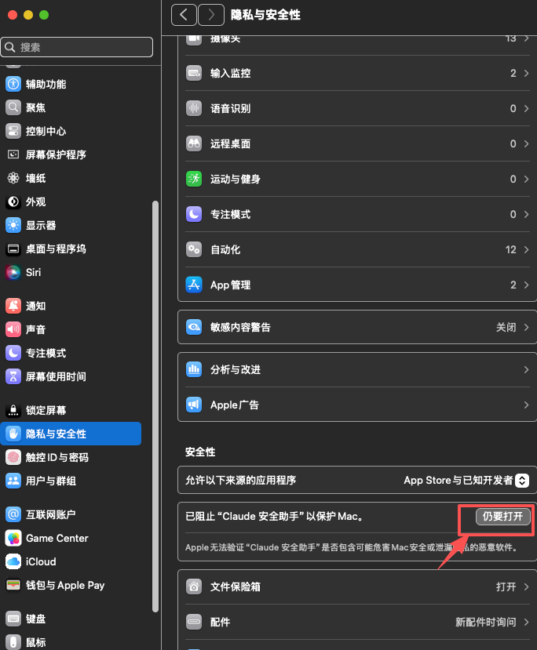

**3. 在确认弹窗里点「仍要打开」。**

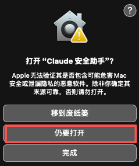

**4. 按系统提示完成管理员验证。** 可以使用管理员的触控 ID，或点「使用密码…」，在系统弹窗中输入这台 Mac 的管理员密码。打开 Claude 安全助手后，继续填写授权信息。

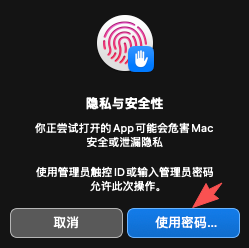

[Apple 支持 · 在 Mac 上安全地打开 App](https://support.apple.com/zh-cn/102445)

## 3. 填写授权信息

在「授权访问」页面填写你的**姓名、手机号和授权码**，然后点「校验授权」。

野路子 AI 内部群的群友可以私信我，免费领取一个授权码。授权码激活后绑定一台电脑，额外电脑需要单独购买授权，私信我即可。

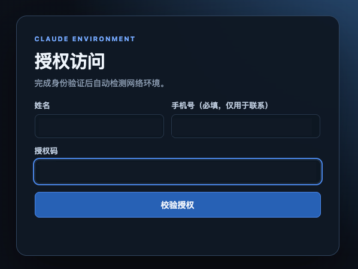

## 4. 检查网络环境

授权通过后，客户端会自动检测「本机代理」和「静态代理」。

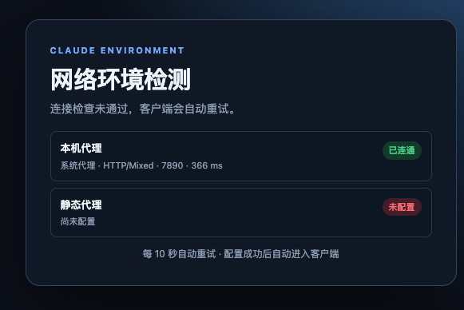

**本机代理**

这项检查的是你这台 Mac 的本机代理有没有连通。群友常问什么叫「科学上网」。最简单的判断方法是打开浏览器，看看 Google 和 YouTube 能不能打开。

如果「本机代理」显示「未配置」或「未连通」，先打开你平时用的代理软件，开启「系统代理」，再回到助手看它有没有变成绿色「已连通」。不知道在哪开，可以把下面这句话发给 Codex。

```text
Claude 安全助手提示我的本机代理没连通。请帮我检查这台 Mac 上已有的代理软件，帮我打开系统代理，再检查 Google 和 YouTube 能不能打开。
```

如果 Google 和 YouTube 还是打不开，这一步需要你先自己解决。等能打开了，再回来继续配置。

**静态代理**

这里用的是你自己购买的静态 IP 对应的 SOCKS5 代理。如果显示「未配置」，保持助手打开，用下一步的 Skill 把自己的代理信息配置进去。

## 5. 用 Codex 配置已有的静态代理

我在网上看到一个人做的SKill，可以用来配置这个小工具，关于配置静态IP的skill，按照下面这个步骤来使用，这个Skill虽然不是我做的。但是我已经实测过，是OK的。群友们放心使用。这个skill其实只需要做两步。第一步是安装。第二步是把你在静态IP上买到的代理地址。端口号用户名和密码。发给你的Codex。

**第一条，安装 Skill。**

在 Codex 新建一个聊天，复制并发送下面两行。

```text
$skill-installer 请帮我安装这个 Codex Skill：
https://github.com/woshishuiwozaina/configure-claude-static-proxy/tree/main/configure-claude-static-proxy
```

**第二条，提交代理信息。**

安装完成后，在同一个聊天里输入 `/skills`，选择「配置 Claude 静态代理」。如果没找到，也可以输入 `$`，搜索 `configure-claude-static-proxy`。

- **发截图**。在 IPFly 找到自己那条 SOCKS5 代理记录，截下能看清代理主机、端口号、账号和密码的一行。把截图附到 Codex 消息，再发下面这句话。

  ```text
  这是我在 IPFly 买的静态代理。请用截图里的代理主机、端口号、账号和密码，帮我配置到 Claude 安全助手。提交后告诉我结果。
  ```

- **发文字**。也可以把同一条记录的四项信息直接发给 Codex。

  ```text
  请把下面这条静态 SOCKS5 代理配置到 Claude 安全助手。
  代理主机  【填写】
  端口号    【填写】
  账号      【填写】
  密码      【填写】
  ```

带代理凭据的截图或文字只发到你自己的 Codex 聊天。下面的实测截图已遮挡代理信息。

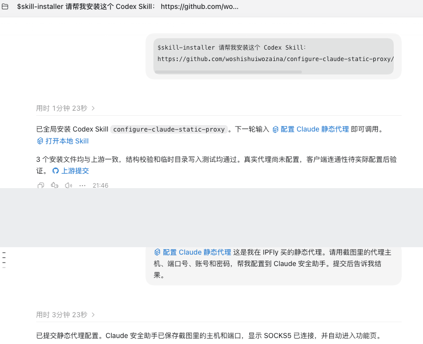

配置时，如果 macOS 提示「Claude 安全助手」想访问其他 App 的数据，确认弹窗里的应用名称后，点「允许」继续。

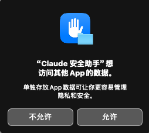

## 6. 确认连通，从助手打开 Claude

看到 Codex 回复「静态代理配置已提交」后，回到 Claude 安全助手。检测页每 10 秒会自动重试，检测通过后会自动进入功能页。

在功能页的「代理与出口」区域，看到 **「SOCKS5 · 已连接」** 和 **「网络全部正常」**，就可以从助手里打开 Claude 客户端或浏览器。

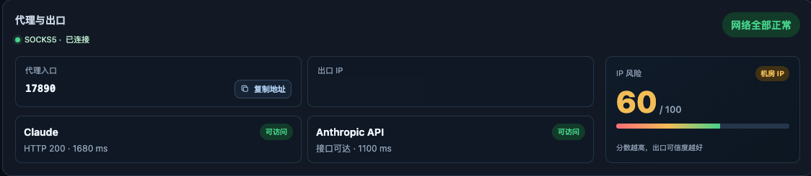

> 我现在在做极限测试。截图里这个 60 分的 IP，这次实测可以正常使用。平时选 IP，评分越高越好。IP 是搭建 Claude 环境的一环，最后还要看助手的整体检测结果。

### 如果还显示红色

截下显示红色状态的区域，先遮住账号、密码和授权码，再发给 Codex。可以直接复制下面这句话。

```text
我在 Mac 上配置 Claude 安全助手，截图里有一项显示红色。请根据截图帮我判断是本机代理、静态代理，还是其他检查没通过，帮我排查并修复。处理后请告诉我回到客户端看哪一项确认。
```
