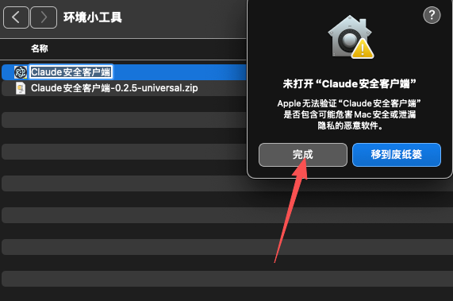
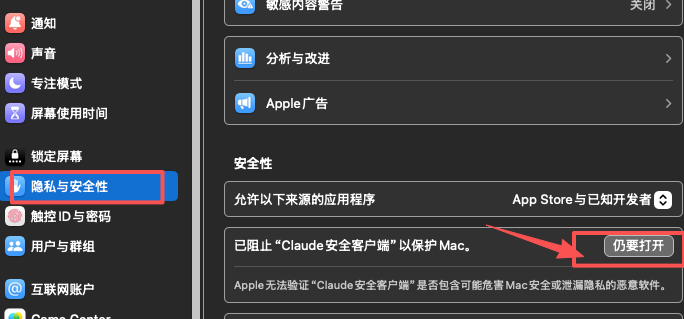
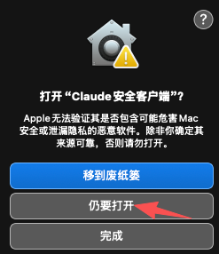
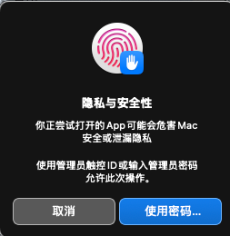
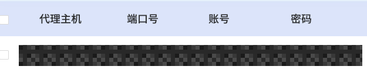
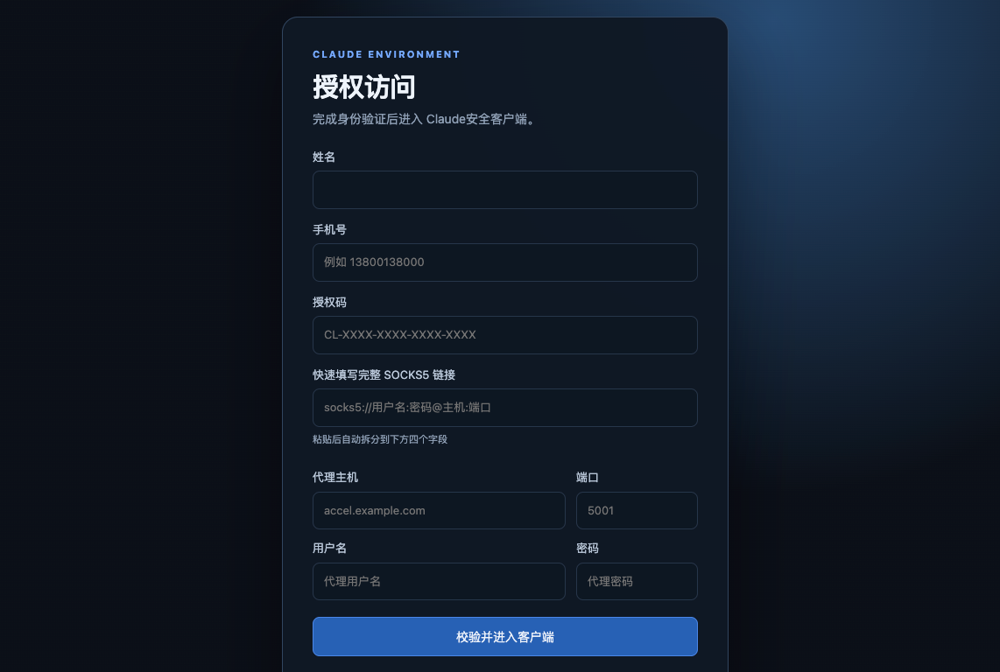
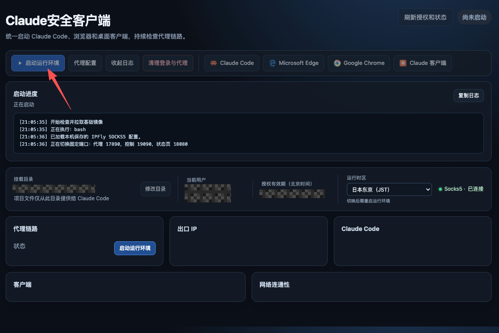
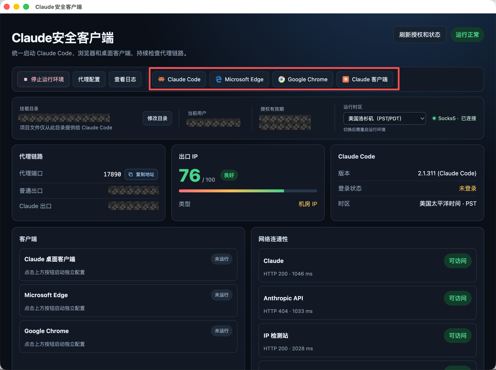
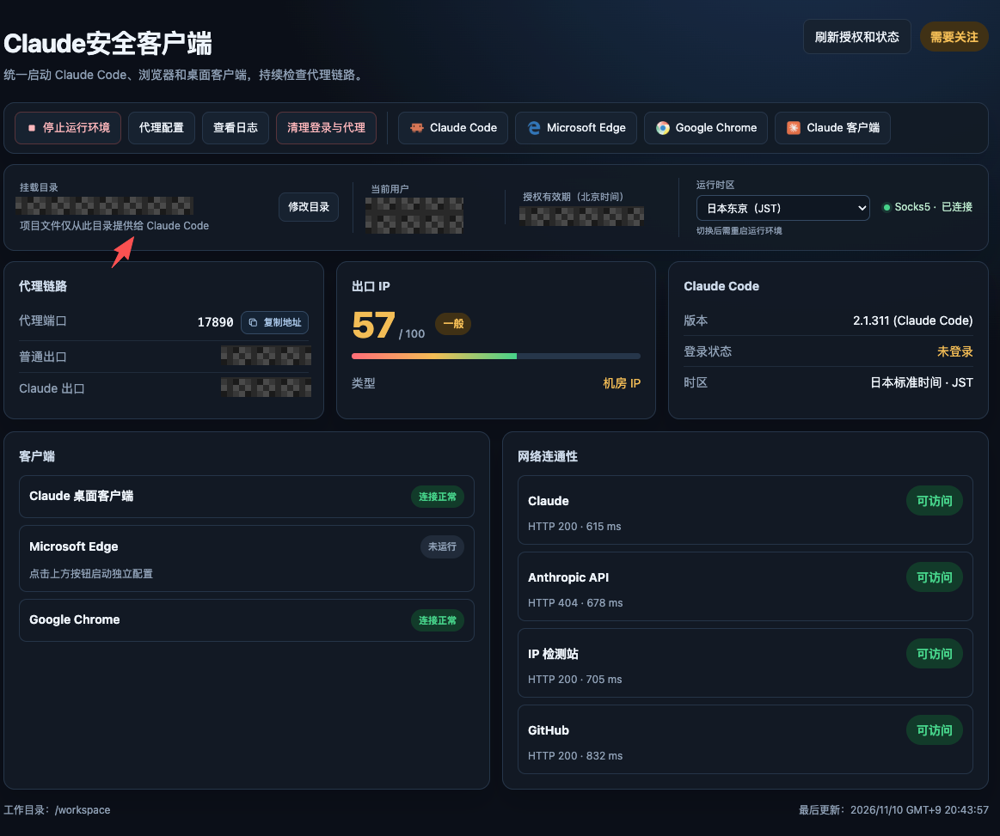
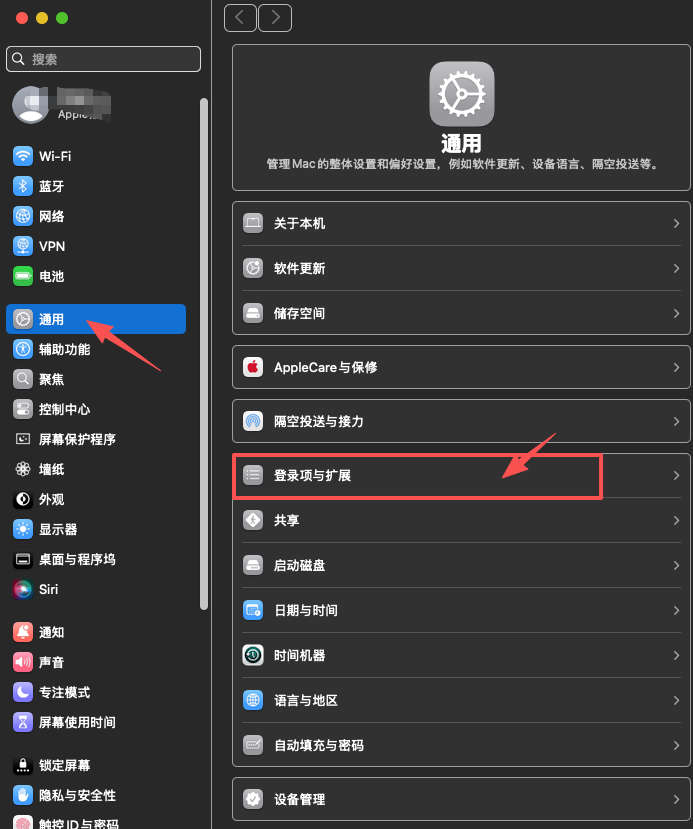

# Claude 安全客户端 Mac 安装与使用指南

本工具仅对内部群友免费。[了解内部群](https://mp.weixin.qq.com/s/qX80eU7RSrndeBHEJtOZvg)。内部群友私信极致先生，获取工具验证码。

我是在「野路子 AI 内部群」和大家讨论时想到做这个工具的。群里不少伙伴已经按我分享的方法用上了 Claude。对刚入群、刚接触 AI 的伙伴来说，自己搭 VPS、配静态 IP 还是有点吃力。我就花了两天做了这个一键部署 Claude 环境的小工具，让大家从一个入口完成配置和启动。

**使用风险说明**

本工具用于配置本地环境和启动 Claude，无法保证 Claude 账号安全或持续可用。截至目前，我、团队成员和已经使用的内部群友都能正常使用。

主流程：**打开工具 → 填写信息 → 启动环境 → 从工具打开 Claude。**Claude Code 按需使用；自启设置和 Codex 检查统一放在文末，作为首次配置的收尾步骤。

开始前，请[下载 Mac 版](https://github.com/markjizhi/claude-safe-client/releases/latest/download/Claude-Safe-Client-macOS.zip)，安装并启动 [Docker Desktop](https://www.docker.com/products/docker-desktop/)。准备好自己的 Claude 账号和工具验证码。

网络方面，无需自行搭建 VPS。电脑必须可以魔法上网。请自备一个支持 SOCKS5 的静态 IP 代理。建议选择评分在 **70 分以上**的出口。[测试静态 IP 评分](https://ip.net.coffee/claude/)

## 1. 首次打开工具

请先确认安装包来源可信。如果工具已经能正常打开，可以直接进入下一节；出现系统拦截提示时，再按下面的步骤操作。

**步骤 1：解压并打开工具**  
解压安装包，双击「Claude安全客户端」。如果出现下图提示，先点击**「完成」**。

**步骤 2：在系统设置中允许打开**  
进入**「系统设置 → 隐私与安全性」**，找到被阻止的「Claude安全客户端」，点击**「仍要打开」**。

**步骤 3：确认打开**  
如果出现下方确认弹窗，再点击**「仍要打开」**。

**步骤 4：完成系统验证**  
按提示使用**触控 ID**或**Mac 管理员密码**完成验证，然后重新打开工具。

## 2. 填写授权与静态 IP 代理信息

进入工具的授权页面后，按下面 3 步填写。所有信息都使用你自己的，不要照抄截图中的示例内容。

**步骤 1：填写工具授权信息**

| 填写项 | 填写说明 |
|-|-|
| 姓名 | 内部群友填写自己在群里的昵称。其他用户填写与工具授权对应的姓名。 |
| 手机号 | 填写你自己的手机号。 |
| 授权码 | 填写分配给你本人的工具验证码。 |

**步骤 2：填写静态 IP 代理信息**  
根据服务商提供的信息，选择下面一种方式填写即可。**方式A和方式B，选1个即可**

**方式 A：粘贴完整 SOCKS5 链接**  
将链接粘贴到**「快速填写完整 SOCKS5 链接」**，再检查下方自动拆出的代理主机、端口、用户名和密码是否正确。

**方式 B：手动填写四项信息**  
如果没有完整链接，直接填写**「代理主机」「端口」「用户名」「密码」**，上方的快速填写框可以留空。这里使用的是代理服务的账号密码。

**以 IPFLY 为例：**登录 [IPFLY 控制台](https://console.ipfly.net/)，在自己的 IP 管理页面找到对应的 SOCKS5 配置，再对照授权页面中的字段逐项填写。其他服务商按其提供的配置填写即可。

**步骤 3：核对并进入客户端**  
检查授权信息和代理配置，确认无误后点击**「校验并进入客户端」**。下图为填写位置示意，实际内容请填写你自己的信息。

如果校验失败，复制页面下方的报错，按第 6 节的求助话术交给 Codex 检查。分享截图或日志前，请隐藏密码、授权码和完整的 SOCKS5 链接。

## 3. 启动运行环境并检查状态

点击工具左上方的**「启动运行环境」**，等待启动完成。首次启动可能需要下载镜像，耗时取决于网络，请不要反复点击。

看到**运行环境已启动、SOCKS5 已连接**，再确认出口 IP 和地区符合自己的预期，就可以继续下一步。若启动失败，按第 6 节向 Codex 求助。

**IP 类型和评分仅供参考，不能代替代理验收。**

## 4. 通过工具打开 Claude

使用桌面端，点击**「Claude 客户端」**；使用网页端，点击**「Google Chrome」**或**「Microsoft Edge」**。在工具打开的窗口中登录自己的 Claude 账号即可。

**以后也从小工具打开 Claude。**不要另外从 Dock、Spotlight 或普通浏览器进入 Claude。

## 5. 使用 Claude Code（按需）

需要使用 Claude Code 时，先点击**「修改目录」**，选择自己的项目文件夹。确认「挂载目录」正确后，再点击上方**「Claude Code」**。

> 截图里的出口 IP 评分是 57 分，这是一次极限测试的结果，当时可以正常使用。日常使用建议选择评分在 70 分以上的出口。

## 6. 遇到问题，怎么向 Codex 求助

遇到无法启动、Docker 报错、端口被占用或代理连接失败时，把小工具拖进 Codex，附上报错截图或日志，再复制下面这段话：

> 我在 Mac 上使用「Claude安全客户端」，现在遇到了问题：【填写问题现象，或附上报错截图】。
> 
> 请检查工具日志、Docker 运行状态、代理连接和端口占用，找出原因并帮我修复。不要修改小工具本身，也不要切换成直连。修复后，请确认工具能正常启动、代理能正常连接，再用简单的话告诉我问题原因和处理结果。

截图和日志中不要包含密码、授权码或完整的 SOCKS5 链接。

## 7. 首次配置收尾：关闭 Claude 自启与重启恢复

**想让 Codex 帮你做收尾检查？** [跳到第 8 步](#8-让-codex-帮你完成收尾检查)。

这是首次配置的收尾步骤。请检查 Claude 登录自启和 macOS 重新打开窗口的设置，避免重启时 Claude 在工具就绪前自行打开。

1. 打开「系统设置 → 通用 → 登录项与扩展」（名称可能随 macOS 版本略有不同），检查「登录时打开」。如果有 Claude，将它移除；如果没有，就不用添加或改动其他项目。
2. 检查 Claude 自身设置里是否有登录时自动启动选项；如有，将它关闭。
3. 重启或关机前，先用 Command + Q 完全退出 Claude，并关闭用于 Claude 的专用浏览器。在系统的确认窗口中，取消勾选「再次登录时重新打开窗口」。这项设置也会影响其他 App 的窗口恢复。

仅关闭窗口不等于退出 App。完成设置后，仍应在方便时实际重启检查：Claude 没有自行打开，再由工具启动。没有做过重启检查，就不要当作已经验证通过。

## 8. 让 Codex 帮你完成收尾检查

点击[下载 Codex 收尾检查文档](https://github.com/markjizhi/claude-safe-client/releases/download/v0.2.5/codex-check.md)。把下载的文档和 Claude 安全客户端一起拖进 Codex，再复制并发送下面这段话。

~~~text
请按这份文档帮我完成首次配置的收尾检查。帮我关闭 Claude 的登录自启，检查 Mac 重新登录时恢复窗口的设置，并确认代理连接正常。

请准备断线测试和重启后的检查。需要实际断线或重启电脑时，先告诉我会影响什么，等我确认后再执行。重启后请帮我确认 Claude 没有自行打开，并检查通过小工具启动时的代理连接。

请保留小工具原样。最后告诉我哪些项目已经验证，还有哪些需要我配合。
~~~
